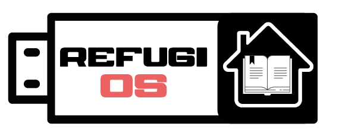

<h1 align="center">
  refugiOS - Tu Refugio Digital y Biblioteca de Supervivencia
</h1>

<p align="center">
  <a href="README.en.md"><strong>🇬🇧🇺🇸 Read this in English</strong></a>
</p>

<p align="center">
  <br />
  
  
  
  
  
</p>

> [!WARNING]
> **Estado del Proyecto:** refugiOS se encuentra actualmente en su **primera versión Beta**. Es un proyecto en desarrollo activo y aún queda camino por delante: corrección de errores y la implementación de funciones detalladas en el roadmap.

> [!IMPORTANT]
> **refugiOS no es una distribución Linux al uso.** No se instala en tu disco duro ni reemplaza tu sistema operativo. Es un sistema portátil que arranca desde un USB y funciona de forma completamente autónoma, sin instalar nada en el ordenador anfitrión. Solo necesitas un USB de 16 GB o más.

## ¿Qué es refugiOS?

**refugiOS** es un sistema operativo portátil pensado para funcionar sin conexión a Internet en situaciones de emergencia o de resiliencia personal. Se instala en un USB y arranca en cualquier PC de 64 bits (con soporte dual tanto para UEFI moderno como para BIOS tradicional) o Raspberry Pi, llevando contigo Wikipedia completa, mapas offline de todo el mundo, una IA privada local, cifrado de archivos personales y guías de supervivencia, todo funcionando sin depender de ningún servidor ni nube.

La idea es sencilla: **prepáralo hoy en casa, úsalo cuando no haya Internet.**

→ Consulta la [Visión y Experiencia del Usuario](doc/Vision-y-Experiencia-ES.md) para una descripción completa del proyecto y qué esperar al usarlo.

---

## Inicio Rápido: Descarga la Imagen Pregenerada

La forma más fácil de tener refugiOS es descargar la imagen ya preparada, grabarla en un USB y arrancar:

### 1. Descarga la imagen

| Idioma | Descarga | Tamaño |
| :--- | :--- | :--- |
| 🇪🇸 **Español** | [refugios-base-16G-es.img.zip](https://refugios.ganso.org/refugios-base-16G-es.img.zip) | 2,9 GB comprimido (16 GB al descomprimir) |
| 🇬🇧🇺🇸 **Inglés** | [refugios-base-16G-en.img.zip](https://refugios.ganso.org/refugios-base-16G-en.img.zip) | 2,9 GB comprimido (16 GB al descomprimir) |

> **Última actualización de las imágenes: 25 de octubre de 2026** (versión 0.27). Si descargaste una imagen anterior a esta fecha, sustitúyela para contar con todas las correcciones, el actualizador, el traductor y la nueva biblioteca.

Descomprime el `.zip` antes de grabarlo: en Windows, clic derecho → *Extraer todo*; en Linux o macOS, `unzip refugios-base-16G-es.img.zip`. Obtendrás el fichero `.img` que se graba en el USB.

> [!TIP]
> **Comprueba que la descarga llegó entera.** Son varios gigabytes y con una conexión inestable el fichero puede quedar incompleto, con el único síntoma de un pendrive que no arranca. Descarga [SHA256SUMS.txt](https://refugios.ganso.org/SHA256SUMS.txt) en la misma carpeta que el `.zip` y comprueba la suma antes de grabarlo:
>
> ```bash
> sha256sum --ignore-missing -c SHA256SUMS.txt   # Linux
> shasum -a 256 --ignore-missing -c SHA256SUMS.txt   # macOS
> ```
>
> En Windows, desde PowerShell: `Get-FileHash refugios-base-16G-es.img.zip -Algorithm SHA256`, y compara el resultado con la línea correspondiente del fichero. Debe responder `OK` o coincidir carácter a carácter; si no, descarga el `.zip` de nuevo.

Necesitas un USB de **al menos 16 GB**. La partición del sistema se expandirá automáticamente al tamaño completo del USB en el primer arranque.

> [!NOTE]
> **¿Por qué no se ofrece una imagen completamente configurada de antemano?**
> Ofrecer una imagen lista con todos los contenidos posibles (Wikipedia completa con imágenes, múltiples modelos de IA local, cartografía de todo el mundo, etc.) exigiría un archivo de descarga descomunal de más de 150 GB. Por eso se distribuye una **imagen base ligera** que el usuario debe configurar en un entorno controlado (no de emergencia) con una buena conexión a Internet. De este modo, en el momento de una emergencia real, el dispositivo tendrá exactamente la información y recursos específicos que necesites.

### 2. Graba la imagen en tu USB

**Desde Windows** — Usa [Rufus](https://rufus.ie/) o [balenaEtcher](https://etcher.balena.io/):
1. Abre Rufus, selecciona tu USB y el archivo `.img` descargado.
2. Asegúrate de que el esquema de partición es **GPT** y el sistema destino es **UEFI**.
3. Pulsa **Empezar** y espera.

**Desde Linux** — Con el comando `dd`:
```bash
# ¡Verifica con lsblk que /dev/sdX es tu USB!
sudo dd if=refugios-base-16G-es.img of=/dev/sdX bs=4M status=progress conv=fsync
```

**Desde macOS** — Usa [balenaEtcher](https://etcher.balena.io/) o el comando `dd`:
```bash
sudo dd if=refugios-base-16G-es.img of=/dev/diskN bs=4M
```

### 3. Arranca desde el USB

1. Conecta el USB a cualquier PC y enciéndelo.
2. Pulsa **F12**, **F8** o **Esc** durante el arranque para seleccionar el USB como dispositivo de inicio.
3. El sistema arrancará automáticamente en el escritorio XFCE con el usuario `refugios` (sin contraseña).

### 4. Completa la instalación

> [!IMPORTANT]
> **Toda la instalación inicial (incluyendo ejecutar este asistente) debe realizarse en un entorno controlado y con conexión a Internet ANTES de que ocurra una emergencia.** Una vez finalizados todos los pasos y comprobado que el sistema funciona correctamente, tu dispositivo estará listo para operar de forma 100% offline.

En el escritorio encontrarás el icono **"Completar instalación de refugiOS"**. Haz doble clic sobre él, conéctate a Internet cuando te lo pida, y el asistente se encargará de descargar e instalar todo el contenido según la capacidad de tu USB.

También puedes ejecutarlo desde la terminal:
```bash
curl -fsSL https://raw.githubusercontent.com/Ganso/refugiOS/main/install.sh | bash
```

> [!TIP]
> La elección del dispositivo físico (pendrive, SSD, adaptador) condiciona el rendimiento y la durabilidad de tu refugiOS. Consulta la **[Guía de Elección del Medio](doc/Eleccion-Medio-Instalacion-ES.md)** antes de comprar.

---

## Métodos Alternativos

La imagen pregenerada es la forma más rápida y sencilla, pero si lo necesitas, también puedes montar refugiOS de otras maneras:

<details>
<summary><strong>💻 Montar refugiOS sobre un Live-USB de Xubuntu</strong></summary>

Si prefieres usar una ISO de Xubuntu como base, puedes crear un USB live con persistencia y después instalar refugiOS sobre él. Este método ofrece un esquema dual alternativo (sistema inmutable + capa de persistencia). (Nota: la imagen pregenerada oficial de refugiOS ya incluye soporte nativo tanto para UEFI como para BIOS tradicional).

1. Descarga [Xubuntu Minimal](https://xubuntu.org/) y créalo como USB persistente con [Rufus](https://rufus.ie/) o [mkusb](https://help.ubuntu.com/community/mkusb).
2. Arranca desde el USB y ejecuta el instalador:
   ```bash
   sudo apt install curl -y
   curl -fsSL https://raw.githubusercontent.com/Ganso/refugiOS/main/install.sh | bash
   ```

Consulta la **[Guía de Instalación en Xubuntu](doc/Instalacion-Xubuntu-ES.md)** para los pasos completos.

</details>

<details>
<summary><strong>🍓 Montar refugiOS en Raspberry Pi</strong></summary>

refugiOS funciona en Raspberry Pi 3B+ y superiores con Raspberry Pi OS:

1. Instala [Raspberry Pi OS (64-bit)](https://www.raspberrypi.com/documentation/computers/getting-started.html#raspberry-pi-imager) con Raspberry Pi Imager.
2. Arranca y ejecuta:
   ```bash
   sudo apt install curl -y
   curl -fsSL https://raw.githubusercontent.com/Ganso/refugiOS/main/install.sh | bash
   ```

El instalador detecta la arquitectura ARM y adapta todo automáticamente. Consulta la **[Guía de Instalación en Raspberry Pi](doc/Instalacion-Raspberry-ES.md)**.

</details>

<details>
<summary><strong>🛠️ Construir tu propia imagen de sistema</strong></summary>

Si necesitas control total sobre la imagen base o quieres preparar múltiples unidades idénticas, puedes generar una imagen desde cero con Debian Trixie + XFCE:

```bash
sudo bash scripts/build_refugios.sh 16G
```

Consulta la **[Guía de Construcción de Imagen de Sistema](doc/Construccion-Imagen-Sistema-ES.md)** para los detalles completos.

</details>

---

## Probar en una Máquina Virtual

Si quieres probar refugiOS antes de grabarlo en un USB, puedes arrancar cualquiera de las imágenes (pregenerada o construida por ti) en una máquina virtual con QEMU o VirtualBox. Esto funciona para x86 (PC y Xubuntu); la Raspberry Pi requiere hardware real.

```bash
# Con QEMU y aceleración KVM (Linux)
sudo qemu-system-x86_64 -enable-kvm -m 4G \
  -bios /usr/share/ovmf/OVMF.fd \
  -drive file=refugios-base-16G-es.img,format=raw
```

Consulta la **[Guía de Virtualización](doc/Guia-Virtualizacion-y-Pendrive-ES.md)** para instrucciones completas con QEMU, VirtualBox y métodos para probar imágenes de Xubuntu.

---

## Características Principales

*   **⚡ Arranca en cualquier PC:** Conectas el USB, enciendes y tu refugio digital funciona. No installs nada en el ordenador anfitrión.
*   **🍓 Soporte nativo para Raspberry Pi:** Instalación certificada en Raspberry Pi 3B+.
*   **📚 Conocimiento Universal Offline:** Wikipedia, enciclopedia médica, guías de emergencia y supervivencia, reparaciones, energía, diccionario y libros, organizados por categorías.
*   **🤖 Inteligencia Artificial Privada:** Asistente que funciona 100% en local, sin Internet.
*   **🗺️ Mapas y Navegación GPS:** Mapas offline de todo el mundo con Organic Maps, con los países más habituales listos desde el instalador.
*   **Traductor sin conexión:** Más de 40 idiomas con los modelos neuronales de Firefox.
*   **Actualizable sin riesgo:** Un icono pone al día libros, mapas, IA y aplicaciones, y no borra nada antiguo hasta verificar lo nuevo.
*   **Comprobación sin conexión:** Un icono revisa que libros, IA, mapas y bóvedas están completos e intactos antes de necesitarlos.
*   **🔒 Bóveda de Archivos Segura:** Cifrado profesional LUKS para proteger documentos sensibles.
*   **🌐 Adaptado a tu Idioma:** El sistema se configura automáticamente en español o inglés.

Consulta el **[Roadmap y Aplicaciones](doc/Modulos-y-Roadmap-ES.md)** para ver el estado actual del proyecto.

### Vídeo de Demostración

<p align="center">
  <a href="https://www.youtube.com/watch?v=ZsVwWdWbtng">
    
  </a>
  <br>
  <em>refugiOS corriendo en un Ryzen 5500, arrancado desde un pendrive USB 3.2 de gama de consumo</em>
</p>

---

## Documentación Detallada

### Fundamentos
*   **[Visión y Experiencia del Usuario](doc/Vision-y-Experiencia-ES.md):** Qué es refugiOS y qué esperar al usarlo.
*   **[Comparativa de Soluciones](doc/Soluciones-Existentes-ES.md):** Por qué refugiOS es diferente a otras alternativas.
*   **[Arquitectura del Sistema](doc/Arquitectura-ES.md):** Detalles técnicos sobre la base Linux y su rendimiento.

### Instalación y Configuración
*   **[Elección del Medio de Instalación](doc/Eleccion-Medio-Instalacion-ES.md):** Qué USB o SSD comprar según tu presupuesto.
*   **[Guía de Virtualización](doc/Guia-Virtualizacion-y-Pendrive-ES.md):** Cómo probar refugiOS en una máquina virtual (QEMU, VirtualBox).
*   **[Instalación en Xubuntu](doc/Instalacion-Xubuntu-ES.md):** Método alternativo sobre Live-USB de Xubuntu.
*   **[Instalación en Raspberry Pi](doc/Instalacion-Raspberry-ES.md):** Guía específica para Raspberry Pi.
*   **[Construcción de Imagen de Sistema](doc/Construccion-Imagen-Sistema-ES.md):** Cómo generar tu propia imagen desde cero.
*   **[Tabla de Compatibilidad](doc/Compatibilidad-ES.md):** Distribuciones y hardware certificado.

### Uso y Mantenimiento
*   **[Bóvedas de Seguridad](doc/Bovedas-Criptograficas-ES.md):** Cómo funciona el cifrado de archivos personales.
*   **[Clonado de Unidades](doc/Clonado-de-Pendrive-ES.md):** Cómo hacer copias exactas de tu USB.
*   **[Aplicaciones y Roadmap](doc/Modulos-y-Roadmap-ES.md):** Módulos disponibles y planificados.

---

## Historial de Versiones

### [0.27] - 2026-10-25

#### Añadido
- **Actualizador integrado (*Actualizar refugiOS*):** Búsqueda y descarga atómica de nuevas ediciones de libros, motor llamafile, modelos de IA y regiones de mapa; la versión antigua solo se sustituye cuando la nueva está descargada y verificada.
- **Traductor neuronal offline (LocalTranslate):** Traducción entre más de 40 idiomas de forma 100% autónoma y privada gracias a modelos integrados.
- **Biblioteca organizada por categorías:** Nuevos catálogos de salud y medicina, supervivencia y emergencias, conocimiento práctico y reparaciones, y educación/libros, accesibles desde la carpeta *Biblioteca refugiOS*.
- **Auditoría de integridad (*Comprobar refugiOS*):** Script de autodiagnóstico sin red que verifica la integridad de libros, IA, mapas y bóvedas con opción de recálculo de sumas criptográficas.
- **Descargas verificadas por defecto:** Descarga mediante metalinks multimirror y BitTorrent con verificación SHA-256 de cada recurso.

#### Corregido
- **Soporte de Flatpaks en Raspberry Pi:** Permite instalar Organic Maps y LocalTranslate vía Flatpak en ARM64 si no hay paquete APT nativo disponible.
- **Retirada de `light-locker`:** Previene bloqueos accidentales de sesión por inactividad en usuarios con autologin sin contraseña.
- **Estimaciones de espacio exactas:** Ajustadas a mediciones reales de la imagen base y paquetes compartidos.

→ Consulta el [CHANGELOG.md](CHANGELOG.md) para el detalle completo de esta versión.

### [0.26] - 2026-09-10

#### Corregido
- **Arranque universal limpio:** Retirada de módulos DKMS propietarios en la imagen base que provocaban bloqueos en `Loading initial ramdisk` en máquinas virtuales y equipos sin GPU NVIDIA reciente.
- **Herramientas de instalación preinstaladas en la imagen:** Se incluyen de serie `dialog`, `aria2`, `jq`, `rsync`, etc., evitando fallos si se ejecuta el instalador sin red.
- **Presets de IA adaptados a la RAM:** El instalador ya no recomienda modelos pesados a equipos con menos de 6 GB de RAM.

#### Añadido
- **Instalación asistida de drivers NVIDIA:** Detección interactiva para aceleración CUDA opcional.

→ Consulta el [CHANGELOG.md](CHANGELOG.md) para el detalle completo de esta versión.

<details>
<summary><b>Versiones anteriores</b></summary>

### [0.25] - 2026-07-30
- Portal web oficial y descargas en [https://refugios.ganso.org](https://refugios.ganso.org).

### [0.24] - 2026-07-29
- Corrección del enlace de autoexpansión de partición en primer arranque y validador de imágenes `tests/verify_image.sh`.

### [0.23] - 2026-07-28
- Carpeta [`media/`](media/README.md) con todo el material gráfico y documentación de la suite de tests en `doc/`.

### [0.22] - 2026-07-28
- Revisión crítica de scripts: confirmación de contraseña en bóvedas LUKS, reanudación de descargas parciales, corrección de Developer Mode y suite de tests automáticos.

### [0.21] - 2026-06-30
- Robustez en diálogos latin-1 (`sanitize_for_dialog`) y comprobación previa de scripts de despliegue.

</details>

→ Consulta el [CHANGELOG.md](CHANGELOG.md) para el historial completo de versiones.

---

## Material Gráfico

La carpeta **[media/](media/README.md)** reúne todo el material gráfico del proyecto:

*   **[Logotipo](media/logo/)** en PNG, PDF vectorial y fuente de Illustrator, más el fondo de escritorio que aplica el instalador. Diseño de [Felipe Monge "PlayOnRetro"](https://x.com/PlayOnRetro); cítalo siempre que lo uses.
*   **[Capturas de pantalla](media/screenshots/README.md)** — cuarenta capturas de las aplicaciones principales funcionando, en español y en inglés, tomadas sobre el sistema real.

---

## Star History

<a href="https://www.star-history.com/?repos=ganso%2Frefugios&type=date&legend=top-left">
 <picture>
   <source media="(prefers-color-scheme: dark)" srcset="https://api.star-history.com/chart?repos=ganso/refugios&type=date&theme=dark&legend=top-left" />
   <source media="(prefers-color-scheme: light)" srcset="https://api.star-history.com/chart?repos=ganso/refugios&type=date&legend=top-left" />
   
 </picture>
</a>

---

## Agradecimientos y Fuentes

Gracias a [Felipe Monge "PlayOnRetro"](https://x.com/PlayOnRetro) por el diseño del logo.

refugiOS es posible gracias al increíble trabajo de proyectos de código abierto como:
*   [Debian](https://www.debian.org/) y [Xubuntu](https://xubuntu.org/) por la base del sistema operativo.
*   [Raspberry Pi Foundation](https://www.raspberrypi.com/) por el hardware y el ecosistema de software ARM.
*   [Kiwix](https://www.kiwix.org/) y la [Fundación Wikimedia](https://wikimediafoundation.org/) por el acceso offline al conocimiento universal.
*   [Mozilla Ocho](https://github.com/Mozilla-Ocho/llamafile) por el motor de inferencia Llamafile.
*   [HuggingFace](https://huggingface.co/) y [unsloth](https://huggingface.co/unsloth) por las cuantizaciones optimizadas de los modelos de IA.
*   Modelos de lenguaje **Qwen3** (Alibaba-Qwen: 0.6B, 8B, 14B) y **Gemma-4** (Google: E4B, 26B-A4B).
*   [Organic Maps](https://organicmaps.app/) y los colaboradores de [OpenStreetMap](https://www.openstreetmap.org/) por la cartografía offline.
*   [Aria2](https://aria2.github.io/) para las descargas de alta eficiencia.
*   [Flatpak](https://flatpak.org/) y [Flathub](https://flathub.org/) por la distribución de aplicaciones modernas.
*   [Cryptsetup / LUKS](https://gitlab.com/cryptsetup/cryptsetup) para la seguridad y cifrado de datos personales.

---
*(refugiOS es una iniciativa de código abierto para la resiliencia digital. Actualmente en fase Beta, buscamos colaboradores para internacionalizar la documentación y pulir la experiencia de usuario según nuestro [Roadmap](doc/Modulos-y-Roadmap-ES.md)).*
